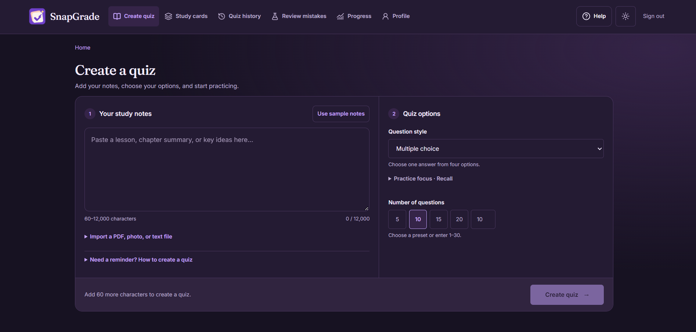

# Jechris Singayan — Portfolio

A personal portfolio showcasing my work in full stack development, web and app development, database management, and system administration. Built with HTML, CSS, and vanilla JavaScript, with a custom cyberpunk monogram and interactive project previews.

## Features

- **Dark and light themes** — dark by default, with a header toggle and a saved preference when browser storage is available.
- **Selected work** — four projects, Web/Python filters, screenshots, and notes about my contributions.
- **Project details** — modal previews with full-size screenshots, Escape-to-close support, and focus restoration.
- **SnapGrade walkthrough** — a playable sample with lesson notes, quizzes, explanations, scores, and mistake review.
- **Rhythm pad** — an eight-step pattern sequencer at 100 BPM, using synthesized audio through the Web Audio API. Playback starts on demand and pauses when the tab is hidden.
- **Contact and résumé** — email copying, email and phone links, social profiles, and a PDF résumé.
- **Responsive layout** — mobile navigation, visible keyboard focus, a skip link, and reduced-motion support.

## Selected projects

| Project | My contribution | Technologies / tools |
| --- | --- | --- |
| **SnapGrade** | Creator and developer | React, Tailwind CSS, Vite, Node.js, Supabase, Groq |
| **PUPQC Gym Reservation System** | Frontend development | HTML, CSS, JavaScript |
| **Integrated Library System** | Frontend and backend development | HTML, CSS, PyCharm |
| **Enhanced Calculator** | Layout design and semantic diagram | Python |

### SnapGrade

SnapGrade is an AI-powered study application that transforms notes into interactive quizzes and flashcards. With multiple question formats, answer explanations, mistake review, and progress tracking, it helps students test their understanding, identify learning gaps, and build confidence through practice.



**Project status:** SnapGrade runs locally. Its application source and backend are separate from this portfolio; no public demo is linked here.

The portfolio includes a **preset interactive sample** of the study flow:

1. Choose **Web requests** or **Database keys** and read the sample notes.
2. Answer three multiple-choice questions.
3. Check each answer and read its explanation.
4. View the attempt's score, accuracy, and mistake review.
5. Start another round or try the other topic.

The sample runs entirely in the browser. It uses fixed lesson data and does not connect to SnapGrade, call an AI service, or require an account. Answers are held in memory and reset when the page reloads.

## Portfolio technology

The portfolio itself uses **HTML5, CSS3, and vanilla JavaScript**, plus SVG assets, the Web Audio API, and browser storage for the theme preference. The React/Node.js stack above belongs to SnapGrade.

No package installation, build step, API key, or environment file is needed to run this portfolio.

## Run locally

From a terminal with Git and Python installed:

```powershell
git clone --branch Big_Update https://github.com/Jechris07/Web-Portfolio-Singayan-1.git
cd Web-Portfolio-Singayan-1
python -m http.server 8765 --bind 127.0.0.1 --directory html
```

Open [http://127.0.0.1:8765](http://127.0.0.1:8765). Stop the server with `Ctrl+C`.

Alternatively, open `html/index.html` with VS Code's Live Server extension. Opening the file directly in a modern browser also works for the main page; a local server is recommended for consistent browser API behavior.

## Project structure

```text
html/
├── index.html                  # Page content, project cards, and case study
├── README.md                   # Source-directory quick reference
├── images/
│   ├── singayan-mark.svg       # Header logo and favicon
│   ├── snapgrade.png           # SnapGrade screenshot
│   └── ...                    # Portrait and other project screenshots
├── pdf/
│   └── Singayan - resume.pdf   # Résumé
├── script/
│   ├── script.js              # Navigation, filters, dialogs, contact, rhythm pad
│   ├── theme.js               # Early theme initialization and toggle
│   └── walkthrough.js         # Preset SnapGrade lessons and quiz state
└── style/
    └── styles.css             # Layout, typography, themes, and responsive styles
```

## Customize

| Update | Location |
| --- | --- |
| Introduction, roles, contact details, or project cards | `html/index.html` |
| Expanded project descriptions | The `notes` object in `html/script/script.js` |
| Sample lessons, questions, answers, or explanations | The `lessons` object in `html/script/walkthrough.js` |
| Colors, spacing, typography, or breakpoints | `html/style/styles.css` |
| Theme behavior | `html/script/theme.js` |
| Logo, screenshots, portrait, or résumé | `html/images/` and `html/pdf/` |

Keep each project card's description consistent with its expanded details. When adding a project, update the initial project count and filter badge in `index.html`, along with its entry in the `notes` object.

## Validation

JavaScript syntax can be checked with Node.js; Node.js is optional for serving the site:

```powershell
node --check html/script/script.js
node --check html/script/theme.js
node --check html/script/walkthrough.js
git diff --check
```

Browser checks performed during development covered theme switching and persistence, project filtering and dialogs, email copying, rhythm controls, and mobile layouts down to 320px. The SnapGrade sample was checked with mixed, perfect, and zero-score attempts, mistake review, restart, topic selection, and keyboard interaction. There is no automated test suite in this repository.

Clipboard access depends on browser permissions and usually requires localhost or HTTPS. If copying is blocked, the page prompts visitors to select the email address manually. Theme switching remains usable when browser storage is unavailable, but the preference cannot persist.

## Static hosting

Serve the contents of **`html/`** as the site's root directory. Keep its `images`, `pdf`, `script`, and `style` folders alongside `index.html` so relative links resolve correctly. No server-side application or build command is required.

## Contact

[Jechris Singayan — Email](mailto:jechrispalku56@gmail.com)
